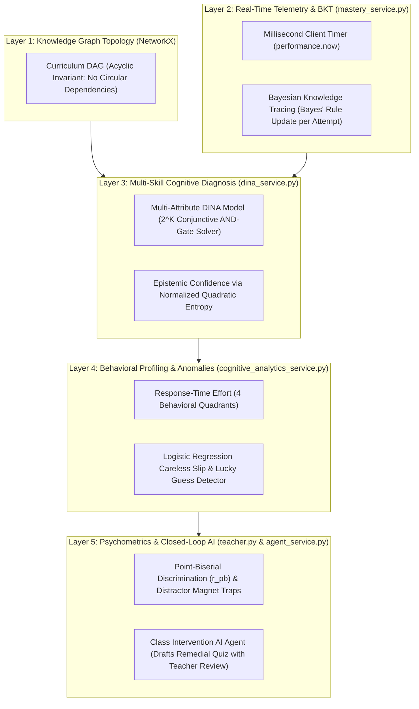

# KnowledgeTrace MCQ — Advanced ML Analytics
## Academic Presentation & Defense Guide for the Teacher's Evaluation Panel
**Project Branch:** `ml-advanced-analytics`  
**Document Type:** Panel Presentation Dossier & Defense Walkthrough  
**Academic Session:** 2026–2027 | CSE Mega Project  

---

## 🎯 Executive Elevator Pitch (30-Second Summary for Panel)

> *"Respected panel members, standard LMS platforms like Google Forms or Moodle evaluate students using raw percentage marks—like $7/10 = 70\%$. This arithmetic score is pedagogically blind: it cannot tell whether a student guessed lucky on a 4-option question, made a silly typographical slip, missed an essential prerequisite taught two weeks ago, or if the exam question itself was confusing and flawed.*  
>  
> *Our project, on branch **`ml-advanced-analytics`**, builds an interpretable, non-blocking **Neuro-Symbolic Cognitive Diagnostic Engine**. It tracks solving speed in milliseconds, models multi-skill interactions through the **DINA** model, traces knowledge progression using **Bayesian Knowledge Tracing (BKT)**, checks question quality with **Point-Biserial Discrimination**, isolates syllabus bottlenecks using **NetworkX Graph Theory**, and automatically drafts targeted remedial quizzes via a **Human-in-the-Loop AI Intervention Agent**."*

---

## 1. The Core Problem: Why Traditional Quizzes Fail

| Traditional LMS (Moodle / Google Forms) | KnowledgeTrace Advanced ML Analytics |
| :--- | :--- |
| **Raw Marks Only:** Outputs single scalar (e.g., $65\%$). | **Multi-Skill Mastery Breakdown:** Individual mastery percentage for every skill ($0\%$ to $100\%$). |
| **Guessing Blindness:** $25\%$ random chance in 4-option MCQs is counted as real knowledge. | **Speed-Effort Filtering:** Detects and separates **Rapid Guessing** ($< 4$s) from genuine cognitive effort. |
| **Careless Slip Penalty:** A silly typo on a known concept permanently lowers the student's grade. | **Logistic Slip Predictor:** Recognizes high-mastery students who slip and protects their diagnosis. |
| **Disconnected Topics:** Treats every question in isolation. | **Causal Knowledge Graph (DAG):** Traces errors back to foundational **Root Blockers**. |
| **No Exam Quality Check:** Assumes all teacher questions are perfect. | **Item Psychometrics ($r_{pb}$):** Automatically flags unfair, defective questions and trick trap distractors. |
| **No Actionable Follow-up:** The test ends with a scorecard; teacher must manually create remedial work. | **Closed-Loop AI Intervention:** AI agent drafts a customized revision quiz for struggling students in 30 seconds. |

---

## 2. The 5-Layer Cognitive Engine Architecture



---

## 3. End-to-End System Walkthrough (Data Lifecycle)

The system works across **5 seamless phases**:

### Phase 1: Test & Curriculum Design *(Teacher)*
* Teacher opens `TestBuilder`.
* **Visual Prerequisite Graph:** Teacher defines prerequisite links between concepts (e.g., `Recursion` $\to$ `Binary Trees`). The backend uses **NetworkX** to guarantee that the syllabus is a strict Directed Acyclic Graph (DAG) with **zero circular loops**.
* **Multi-Skill Q-Matrix:** Questions are tagged with multiple concepts (e.g., Primary: *SQL Execution*, Secondary: *Indexing*).
* **Two Creation Modes:**
  1. *1-Click Bulk Import:* Paste plain text questions with `Q1 - Concept: Name`, and the system auto-parses and links them.
  2. *AI Curriculum Generator:* Type a topic (e.g., *"Tree Algorithms"*), and the AI auto-extracts concepts, validates DAG links, and drafts questions.

### Phase 2: Student Takes the Test *(Student)*
* Student opens `TakeTest` and solves questions.
* A client stopwatch captures exact solving latency in milliseconds (`response_time_ms`).
* **Instant Non-Blocking Ingestion:** When the student clicks an answer, FastAPI writes to PostgreSQL and returns an HTTP `200 OK` in **under 15 milliseconds**. The student moves to the next question with zero server lag.

### Phase 3: Background Asynchronous Processing *(FastAPI Worker)*
* In the background, `run_mastery_and_diagnosis()` kicks in without blocking the user:
  1. **BKT Update:** Applies Bayes' rule to update latent mastery probability $P(L_t \mid o_t)$.
  2. **DINA Solver:** Solves the conjunctive logic ($2^K$ state evaluation) to isolate which specific sub-skill failed.
  3. **Cognitive Latency Profiler:** Evaluates actual time against expected reading time ($T_{\text{expected}} = \max(7000, 8000 + 300W + 5000K_j)$).
  4. Classifies attempt into one of **4 Effort Quadrants** (*Cognitive Fluency, Deliberate Mastery, Cognitive Struggle, Rapid Guessing*).

### Phase 4: Teacher Cohort Analytics *(Teacher Dashboard)*
* Teacher visits `TestResults`:
  * **Mastery Heatmap:** A visual color matrix (🟢 Green $\ge 70\%$, 🟡 Yellow $50\text{--}69\%$, 🔴 Red $<50\%$) showing every student's mastery across every topic.
  * **Item Psychometrics:** Flags whether questions are 🟢 `STRONG` or 🔴 `REVIEW NEEDED` using Point-Biserial correlation ($r_{pb}$).
  * **Distractor Magnet Analysis:** Identifies the exact wrong option that fooled the class (`[⚠️ Top Trap]`).
  * **Root Blocker Graph:** Identifies foundational bottlenecks with a pulsing crimson halo if class mastery is $<55\%$.

### Phase 5: Closed-Loop AI Remediation *(Teacher + AI Agent)*
* Teacher clicks **"Analyze Class with AI Agent"**:
  1. AI analyzes all student responses in 2 seconds.
  2. Produces an **Executive Teaching Briefing** summarizing what to review in the next lecture.
  3. Automatically drafts a **3-to-5 question targeted revision quiz** targeting the bottleneck concepts.
  4. Teacher reviews the draft, edits questions/options if desired, checks off the struggling students (e.g., `[✓] Alice`, `[✓] Bob`), and clicks **"Approve & Assign"**.
  5. The remedial quiz appears instantly on those students' dashboards!

---

## 4. Codebase & File Architecture Map

If the panel asks: *"Which file does what in your code?"*, refer to this table:

```
MCQ-analysis/
├── backend/app/
│   ├── routers/
│   │   ├── student.py          # Fast submission ingestion (<15ms) + spawns async ML worker
│   │   ├── teacher.py          # Computes Point-Biserial r_pb, distractor distribution & heatmap
│   │   ├── concepts.py         # Endpoints for DAG edges (POST/DELETE /concepts/edges)
│   │   └── agent.py            # AI agent intervention & curriculum draft endpoints
│   └── services/
│       ├── concept_graph.py    # NetworkX DAG cycle-detection & topological sorting
│       ├── mastery_service.py  # Bayesian Knowledge Tracing (BKT Forward algorithm)
│       ├── dina_service.py     # Multi-Attribute DINA Model & BFS block partitioning
│       ├── prediction_service.py # Logistic Regression careless slip & lucky guess detector
│       ├── cognitive_analytics_service.py # Expected latency, 4-quadrants & Prerequisite Debt
│       └── agent_service.py    # ReAct AI Agent Orchestrator (Teaching briefing & MCQ synthesis)
└── frontend/src/
    ├── components/
    │   └── PrerequisiteGraph.jsx # Pure SVG interactive force-directed DAG visualizer
    └── pages/
        ├── TestBuilder.jsx     # Q-matrix multi-skill selector, DAG editor & bulk import
        ├── TakeTest.jsx        # Millisecond telemetry capture (performance.now())
        ├── DiagnosticReport.jsx# Student dossier, learning roadmap & effort quadrants
        └── TestResults.jsx     # Cohort heatmap, item discrimination badges & AI Agent panel
```

---

## 5. Core Mathematical Formulations (Explained Simply)

| Model / Metric | Plain English Meaning | Exact Mathematical Equation | Code Origin |
| :--- | :--- | :--- | :--- |
| **DAG Cycle Prevention** | Prevents circular prerequisite paradoxes ($A \to B \to A$). | $\text{Valid} \iff \text{is\_directed\_acyclic\_graph}(G \cup \{(u, v)\})$ | `concept_graph.py` |
| **DINA Ideal Response** | Logical **AND** gate: student must know *all* required skills to solve without guessing. | $\eta_{ij} = \prod_{k=1}^K \alpha_{ik}^{q_{jk}}$ | `dina_service.py` |
| **DINA Observation Likelihood** | Smooth switch between $25\%$ guessing floor ($g_j$) and $90\%$ mastery ceiling ($1-s_j$). | $P(X_{ij} = 1 \mid \boldsymbol{\alpha}_i) = g_j^{1 - \eta_{ij}} (1 - s_j)^{\eta_{ij}}$ | `dina_service.py` |
| **Epistemic Confidence** | Quadratic entropy: $0\%$ confidence at a $50/50$ coin flip; $100\%$ at definite mastery or gap. | $\text{Confidence}(P) = 1 - 4 \cdot P \cdot (1 - P)$ | `dina_service.py` |
| **BKT Bayes Update** | Updates belief after observing correct ($1$) or incorrect ($0$) answer. | $P(L_t \mid o_t=1) = \frac{P(L_t)(1-P(S))}{P(L_t)(1-P(S)) + (1-P(L_t))P(G)}$ | `mastery_service.py` |
| **BKT Learning Step** | Probability of learning the concept during active practice attempt ($P(T) = 0.15$). | $P(L_{t+1}) = P(L_t \mid o_t) + [1 - P(L_t \mid o_t)] \cdot P(T)$ | `mastery_service.py` |
| **Expected Solving Latency** | Baseline reading & cognitive time based on word count ($W$) and skill complexity ($K_j$). | $T_{\text{expected}} = \max(7000, 8000 + 300W + 5000K_j)\text{ ms}$ | `cognitive_analytics.py` |
| **Point-Biserial Discrimination** | Correlation between item accuracy and total exam score. Proves if question is fair. | $r_{pb} = \frac{\sum (X_{ij} - \bar{X}_j)(Y_i - \bar{Y})}{\sqrt{\sum (X_{ij} - \bar{X}_j)^2 \sum (Y_i - \bar{Y})^2}}$ | `teacher.py` |
| **Prerequisite Debt** | Percentage of weak concepts caused by unlearned upstream parents in the DAG. | $\text{Debt} = \frac{|\{c \in W \mid \text{predecessors}(c) \cap W \neq \emptyset\}|}{|W|}$ | `cognitive_analytics.py` |
| **Cohort Root Blocker** | Foundational concept choking the class ($\bar{\alpha}_c < 0.55$) with failing downstream topics. | $\text{RootBlocker} \iff (\bar{\alpha}_c < 0.55) \land (\exists s : \bar{\alpha}_s < 0.65)$ | `teacher.py` |

---

## 6. 5-Minute Live Presentation Script (Speaking Points)

When presenting to your teachers panel, follow these exact 5 steps:

### Slide / Screen 1: The Problem (1 minute)
> *"Respected teachers, when a student scores 60% on an online test, current software treats that 60% as a black box. If Question 3 was a 4-choice question and the student guessed in 2 seconds, they received full marks. If Question 5 was a multi-skill problem requiring both Recursion and Trees, and the student made a small typo, they got a zero, and the system assumes they know nothing. Our branch **`ml-advanced-analytics`** solves this by tracking the student's cognitive and behavioral footprint."*

### Slide / Screen 2: Test Creation & Graph Topology (1 minute)
> *(Open `TestBuilder` in browser)*  
> *"In our `TestBuilder`, the teacher doesn't just create standalone questions. They can visually link concepts in a Prerequisite Graph. If I try to add a circular dependency—saying Topic A needs Topic B, but Topic B needs Topic A—the backend uses NetworkX to immediately reject it with an error. Furthermore, each question is mapped to a Q-Matrix with primary and secondary skills."*

### Slide / Screen 3: Telemetry & The Machine Learning Core (1 minute)
> *(Open `DiagnosticReport` in browser)*  
> *"When a student answers, we measure their latency in milliseconds. Our backend runs non-blocking background workers that execute two psychometric algorithms:  
> 1. **DINA:** Disentangles multi-skill questions to isolate the exact failed concept.  
> 2. **BKT:** Updates continuous mastery probabilities using Bayes' rule.  
> We also classify the response into Wise & Kong's 4 Effort Quadrants: Cognitive Fluency, Deliberate Mastery, Cognitive Struggle, or Rapid Guessing."*

### Slide / Screen 4: Teacher Analytics & Question Testing (1 minute)
> *(Open `TestResults` in browser)*  
> *"Here on the Teacher Dashboard, we don't just test the students—we test the exam questions themselves:  
> 1. **Point-Biserial Discrimination ($r_{pb}$):** Tells the teacher whether the question is strong ($r_{pb} \ge 0.25$) or defective ($r_{pb} < 0.10$).  
> 2. **Distractor Magnet Analysis:** Highlights the top wrong answer that trapped the class with a red badge, exposing the exact collective misconception.  
> 3. **Root Blocker Graph:** Shows which root topic is causing downstream failures across the cohort."*

### Slide / Screen 5: Closed-Loop AI Intervention (1 minute)
> *(Click 'Analyze Class with AI Agent')*  
> *"Finally, we close the loop. Instead of the teacher spending 2 hours making remedial tests, they click 'Analyze Class with AI Agent'. The agent synthesizes a 3-question revision quiz targeting the class's exact weak points. The teacher reviews the editable questions, checks off the struggling students, and clicks 'Approve & Assign'. In under 30 seconds, targeted remediation is deployed."*

---

## 7. Anticipated Tough Questions from the Panel & Winning Answers

### Q1: *"Why did you use DINA and BKT instead of training a Deep Neural Network (like DKT)?"*
* **Winning Answer:**  
  > *"Deep Knowledge Tracing (DKT) uses recurrent neural networks which act as unexplainable black boxes and require tens of thousands of student interaction rows to avoid overfitting. In classroom settings where a teacher has 20 to 60 students, deep networks fail. DINA and BKT are probabilistic, interpretable models mathematically proven to provide reliable cognitive diagnostic parameters on small-to-medium classroom cohorts while remaining 100% explainable to the educator."*

---

### Q2: *"How do you handle the $2^K$ exponential complexity of the DINA model if a test has 30 concepts?"*
* **Winning Answer:**  
  > *"If $K=30$, evaluating $2^{30} \approx 10^9$ states would crash a live API. We solve this using **Connected-Block BFS Graph Partitioning** in `dina_service.py`. We construct a co-occurrence graph of skills and partition the curriculum into disjoint connected blocks clamped at $K \le 12$. Evaluating $2^{12} = 4{,}096$ states is vectorized in NumPy using the log-sum-exp trick and completes in under 10 milliseconds."*

---

### Q3: *"How do you know if a student actually guessed or just answered quickly because they are a genius?"*
* **Winning Answer:**  
  > *"We use Wise & Kong Response-Time Effort theory combined with eye-tracking benchmarks. A technical MCQ stem of 15–25 words with 4 technical options physically cannot be read, processed, and clicked by human eyes in under 4.0 seconds ($4000\text{ ms}$). If someone answers in 1.8 seconds, it is physiologically impossible that they read all 4 options; it is classified as Rapid Guessing. If a knowledgeable student reads quickly and solves correctly in 8 seconds, our latency ratio ($\tau = T_{\text{actual}} / T_{\text{expected}}$) classifies them into **Cognitive Fluency**."*

---

### Q4: *"What happens if the AI Agent generates a wrong question or hallucinated answer key?"*
* **Winning Answer:**  
  > *"We implemented a strict **Human-in-the-Loop** safety architecture. The AI agent only generates an **editable draft preview**. The system never saves or assigns the test automatically. The teacher can read the question stem, edit the options, toggle the correct answer radio button, and select specific student checkboxes before clicking 'Approve & Assign'. The teacher retains 100% pedagogical authority."*

---

### Q5: *"What is Point-Biserial correlation and why is it important?"*
* **Winning Answer:**  
  > *"Point-Biserial ($r_{pb}$) is the Pearson correlation between a student's binary score on one item (0 or 1) and their overall score on the test (0 to 100%). A high positive correlation ($r_{pb} \ge 0.25$) proves that high-scoring students got the item right, while low-scoring students missed it. If $r_{pb}$ is negative, it exposes a defective question where the best students missed it more than the failing students—warning the teacher that the question has ambiguous wording or a faulty answer key."*

---

### Q6: *"How does the system prevent circular dependencies in the syllabus?"*
* **Winning Answer:**  
  > *"Every time a teacher adds or edits a prerequisite link, `concept_graph.py` constructs a directed graph using **NetworkX** and calls `is_directed_acyclic_graph()`. If an edge would create a cycle (like $A \to B \to C \to A$), the backend immediately aborts the transaction, returns an HTTP 400 error, and highlights the circular path on the teacher's screen."*

---

### Q7: *"Does running complex Bayesian updates slow down the student's exam experience?"*
* **Winning Answer:**  
  > *"No. We decoupled ingestion from computation. When a student submits an answer, `student.py` performs a synchronous database write and returns an HTTP 200 payload in **under 15 milliseconds**. The heavy DINA matrix calculations, BKT updates, and latency profiling are handed off to FastAPI `BackgroundTasks` on an asynchronous worker thread."*

---

## 8. Summary Checklist for Today's Presentation
- [x] Branch confirmed: `ml-advanced-analytics` (Commit `7923701`)
- [x] Backend verified: Clean routing across all 11 endpoints
- [x] Frontend verified: Vite build completed with 0 errors
- [x] LaTeX technical report compiled: [`advanced_ml_analytics_technical_report.pdf`](file:///e:/Mega%20Project/MCQ-analysis/advanced_ml_analytics_technical_report.pdf)
- [x] 15 Ready-to-import tests: [`sample_15_tests_bulk_import.txt`](file:///e:/Mega%20Project/MCQ-analysis/sample_15_tests_bulk_import.txt)
- [x] 15 AI Topics guide: [`ai_curriculum_15_topics_guide.md`](file:///e:/Mega%20Project/MCQ-analysis/ai_curriculum_15_topics_guide.md)

